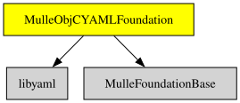

# MulleObjCYAMLFoundation

#### 🍲 YAML support for mulle-objc

YAML parsing and writing for mulle-objc, so that YAML can be used as a property
list format. Reading is built on [libyaml](//github.com/yaml/libyaml) and
resolves plain scalars the way Ruby's Psych does: "yes" is a boolean, "08" is
a string and "1.20" is a float. Writing produces block style YAML that reads
back as the same property list.


| Release Version                                       | Release Notes  | AI Documentation
|-------------------------------------------------------|----------------|---------------
|  [](//github.com/MulleWeb/MulleObjCYAMLFoundation/actions) | [RELEASENOTES](RELEASENOTES.md) | [DeepWiki for MulleObjCYAMLFoundation](https://deepwiki.com/MulleWeb/MulleObjCYAMLFoundation)


## Usage

### Reading YAML

``` objc
#import <MulleObjCYAMLFoundation/MulleObjCYAMLFoundation.h>

MulleYAMLParser   *parser;
id                plist;

parser = [MulleYAMLParser parser];
plist  = [parser parseData:data];
if( ! plist)
   mulle_printf( "%@\n", [parser problem]);
```

Through the plist API the YAML format has to be forced:

``` objc
NSPropertyListFormat   format;

format = MullePropertyListYAMLFormat;
plist  = [NSPropertyListSerialization mullePropertyListFromData:data
                                               mutabilityOption:0
                                                         format:&format
                                                   formatOption:MullePropertyListFormatOptionForce];
```

`NSString` has a shortcut:

``` objc
plist = [@"title: My Post\ntags:\n   - one\n   - two\n" mulleYAML];
```

### Writing YAML

``` objc
NSData   *data;

data = [MulleYAMLWriter dataWithPropertyList:plist];
```

Or through the plist API:

``` objc
NSError   *error;
NSData    *data;

data = [NSPropertyListSerialization dataWithPropertyList:plist
                                                   format:MullePropertyListYAMLFormat
                                                  options:0
                                                    error:&error];
```

### Detection

YAML has no magic bytes, so a format detector looks for a `key:` mapping, a
block sequence or a `---` document marker. A flow collection is not claimed,
because it is indistinguishable from JSON. When in doubt, force the format.


## API

### Classes

| Class               | Description
| ------------------- | ----------------------------------------------
| `MulleYAMLParser`   | reads YAML into a property list
| `MulleYAMLWriter`   | writes a property list as YAML

`NSPropertyListSerialization( YAML )` registers `MullePropertyListYAMLFormat`
as both a readable and a printable property list format. `NSString` gets a
convenience `-mulleYAML` method.


## Info

This library needs [libyaml](//github.com/yaml/libyaml) and
[MulleFoundationBase](//github.com/MulleFoundation/MulleFoundationBase).

A plain (unquoted) `!!str` scalar is still resolved through the core schema,
so `!!str 123` reads as the number 123. Quote it (`!!str "123"`) to keep it a
string. This is a known quirk, not a bug.

### You are here




## Add

Use [mulle-sde](//github.com/mulle-sde) to add MulleObjCYAMLFoundation to your project:

``` sh
mulle-sde add github:MulleWeb/MulleObjCYAMLFoundation
```

## Install

### Install with mulle-sde

Use [mulle-sde](//github.com/mulle-sde) to build and install MulleObjCYAMLFoundation and all dependencies:

``` sh
mulle-sde install --prefix /usr/local \
   https://github.com//MulleObjCYAMLFoundation/archive/latest.tar.gz
```

### Manual Installation

Install the requirements:

| Requirements                                 | Description
|----------------------------------------------|-----------------------
| [libyaml](https://github.com/yaml/libyaml)             | 
| [MulleFoundationBase](https://github.com/MulleFoundation/MulleFoundationBase)             | 🧱 MulleFoundationBase amalgamates Foundations projects
| [mulle-objc-list](https://github.com/mulle-objc/mulle-objc-list)             | 📒 Lists mulle-objc runtime information contained in executables.

Download the latest [tar](https://github.com/MulleWeb/MulleObjCYAMLFoundation/archive/refs/tags/latest.tar.gz) or [zip](https://github.com/MulleWeb/MulleObjCYAMLFoundation/archive/refs/tags/latest.zip) archive and unpack it.

Install **MulleObjCYAMLFoundation** into `/usr/local` with [cmake](https://cmake.org):

``` sh
PREFIX_DIR="/usr/local"
cmake -B build                               \
      -DMULLE_SDK_PATH="${PREFIX_DIR}"       \
      -DCMAKE_INSTALL_PREFIX="${PREFIX_DIR}" \
      -DCMAKE_PREFIX_PATH="${PREFIX_DIR}"    \
       -DCMAKE_BUILD_TYPE=Release &&
cmake --build build --config Release &&
cmake --install build --config Release
```

### Platforms and Compilers

All platforms and compilers supported by
[mulle-c11](//github.com/mulle-c/mulle-c11).


## Author

[Nat!](https://mulle-kybernetik.com/weblog) for Mulle kybernetiK  

